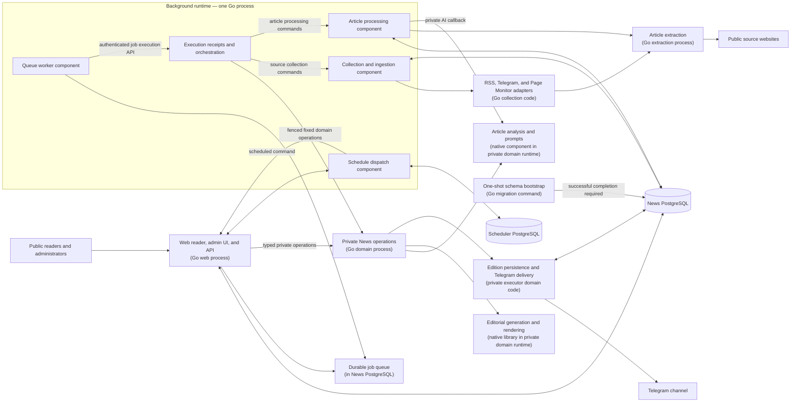

# Evening News

Evening News collects stories from RSS/Atom feeds, public Telegram channels, and monitored web pages. It extracts article text, filters low-quality content, generates AI summaries and categories, and publishes daily digests to Telegram and the public reader.

**Live site:** [news.dzarlax.dev](https://news.dzarlax.dev)

## What it does

1. Collects articles from configured feeds, Telegram channels, and custom pages.
2. Extracts full text from linked articles when a source provides only a snippet.
3. Filters duplicate, short, and boilerplate content before article analysis.
4. Summarizes and categorizes articles, then creates daily summaries by category.
5. Publishes digests to Telegram and links to the public site.

## Architecture

The application is organized around product responsibilities. The diagram describes the current development candidate and its logical responsibilities; it does not imply a production deployment.



The Go web service serves the public reader, admin pages, health endpoints, and management APIs. One Go background process hosts the scheduler, queue worker, ingestion, article processing and execution components. The private Go domain process owns analysis, callbacks, editorial generation, Telegram delivery and maintenance. The extractor remains a separate Go service. The private domain and background processes communicate over authenticated HTTP and use database-backed ownership fences.

The managed profile runs a one-shot database provisioner before schema-dependent services start; the web and domain processes do not apply migrations at startup. In the legacy profile, `WEB_BACKEND_URL` names the private domain origin, and `WEB_BACKEND_TOKEN` is shared by the web and domain processes. Provider credentials belong to the domain process, not the web process. Delivery receipts and failure semantics are described in [Go digest delivery](docs/go-digest-delivery.md).

The final Go domain migration is a development candidate. The image acceptance, recovery and backup gates must pass before it can be considered ready for release; no deployment is implied by the source tree.

## Editorial digests

Article analysis and editorial generation use the private domain runtime. The Russian editorial format presents main stories first, followed by short stories grouped by category. The editorial engine is linked into that process. Stored editions preserve their article snapshot and source links. Headlines open a page on this site, while source labels open the original publication. See [editorial digest contracts and boundaries](docs/editorial-digests.md).

## Admin panel

The admin UI is served at `/admin`. It provides source and category management, summaries and statistics, Telegram settings, schedule settings, and backup operations. Commands that run asynchronously are submitted to the durable job queue and report a job receipt. In worker mode, offline backup mutations such as upload, cleanup, and restore are disabled by the private executor.

## Public reader and API

The public reader is available at `/` and `/list`, with search at `/search` and daily digests at `/digest/YYYY-MM-DD`. It includes filtering by category and source, dark mode, and a responsive article view.

Public data endpoints live under `/api/public/`; the authenticated management API lives under `/api/v1/`. The route ledger is in [Go web route coverage](docs/web-api-route-coverage.md), and the frozen historical Python route/schema snapshot remains under `tests/fixtures/web-contract-v1/` for migration tests. The public OpenAPI contract is `go-web/contracts/openapi.json` and is served at `/openapi.json` with local documentation at `/docs` and `/redoc`.

## Local development

For a fresh installation, the managed Compose profile starts the Go web service, one background runtime, the private Go domain process, the extractor, and one PostgreSQL 17 server. It creates separate News and scheduler databases and least-privilege runtime roles on that server. Private per-role configuration, database passwords, service tokens, and signing keys are generated into persistent local volumes. No AI provider or Telegram key is needed to start the app. HTTP-only extraction is the zero-configuration default; an optional protected setup flow can attach a fresh install to an existing native browser and egress stack without creating browser services.

The only optional `.env` value is `SITE_BASE_URL`. Leaving it unset uses `http://localhost:8000`. The local HTTP exception requires a loopback site origin, and the host port is bound to `127.0.0.1`. Public sites require HTTPS; trusted proxy CIDRs are supplied separately through a protected installer options file.

```sh
cp .env.example .env
make managed-up
make managed-token
```

Open [http://localhost:8000/setup](http://localhost:8000/setup), paste the one-time token printed by `make managed-token`, and create the first administrator. The token expires after 15 minutes and is consumed when the account is claimed. Then configure AI, Telegram, sources, categories, and scheduling in the setup screens. Saving AI settings does not send a provider request. Use `make managed-logs` to inspect service logs and `make managed-stop` to stop services while preserving installation data.

`make dev` remains the separate legacy Compose profile. Its detailed DSNs, service environment and migration steps are in the [legacy local deployment guide](deploy/news/README.md) and [legacy environment example](.env.legacy.example). The [configuration guide](docs/configuration.md) covers the complete catalog, the protected native-browser attach flow, separately gated external-database installation, and dry-run/apply workflow for existing-installation adoption. The `.env.full.example` and machine-readable catalog cover advanced generator and operator inputs across supported profiles.

## AI providers

The installation uses one active provider for article analysis, editorial digest generation, and auxiliary text generation. Gemini is the default; OpenAI can be selected with its own model for each purpose. In the managed profile, enter provider credentials in the admin AI settings; values are stored encrypted in PostgreSQL and the UI does not return them. In the legacy profile, provider keys come from the private domain process environment. Saved provider/model settings take precedence over initial environment defaults. There is no automatic fallback to another provider; a missing active key or model is an error.

For legacy configuration, set `GEMINI_API_KEY`; `SUMMARIZATION_MODEL` selects the article model, `DIGEST_MODEL` the digest model, and optional `TEXT_MODEL` defaults to the summarization model. To use OpenAI, set `AI_PROVIDER=openai`, `OPENAI_API_KEY`, `OPENAI_ARTICLE_MODEL`, `OPENAI_DIGEST_MODEL`, and `OPENAI_TEXT_MODEL`. OpenAI model names have no built-in defaults. Keep provider secrets out of the web, background and extractor environments.

Optionally set `AI_MODEL_PRICES` in the executor environment to a JSON object keyed by `provider/model`. Each value has three non-negative numeric fields: `input`, `output`, and `cached_input`, in USD per million tokens. For example, `{"openai/example-model":{"input":1,"output":2,"cached_input":0.5}}` demonstrates the format only; these numbers are not vendor prices. The runtime looks up the provider-reported model first, then the requested model when an explicit price exists for that alias. Leave the value empty when prices are not configured: the corresponding cost is unknown. Cached input is charged at its configured rate instead of being counted again at the ordinary input rate.

The independent [go-ai module](https://github.com/Dzarlax-AI/go-ai), pinned at `v0.1.0`, supplies provider-neutral text and structured JSON requests and one HTTP attempt per call. News retains its own validation, retry policy, costs and editorial rules. Usage fields that the provider does not supply remain unknown; cached input is part of input and reasoning is part of output. Unknown usage or pricing must not be presented as free.

The local provider tests use synthetic responses. Real-provider behavior and editorial quality require separate acceptance, including approval of the calls and their cost.

## Tests

`make test` and `make vet` cover the News Go modules; the external go-ai module has its own CI. The Go components can also be checked independently with `go test -race ./...`, `go vet ./...`, and `go mod verify` from each module directory. PostgreSQL integration tests require `TEST_DATABASE_URL` to point to a dedicated loopback test database. Do not use a production or shared database.

The News application and its tooling use Go. The separate shared browser retains its existing Python runtime; its isolated contract and Cloak fixture checks use Go. Exact-head CI remains pending; see [the Go tooling coverage map](go-tools/COVERAGE.md) for verified checks and remaining validation.

## Configuration and documentation

The [configuration guide](docs/configuration.md) describes managed and legacy profiles and links the complete machine-readable environment catalog. The catalog records each deployable name's owner, type, default, secret status, storage, reload behavior, migration notes, precedence, source locations and managed role allowlist. `WEB_BACKEND_URL` must be a fixed private domain origin; the client does not accept arbitrary backend paths or URLs. The older multi-DSN Compose profile remains documented in [the legacy News deployment guide](deploy/news/README.md).

English technical guides:

- [Web/API components](docs/web-api-components.md)
- [Core image build and release](docs/core-image-build-and-release.md)
- [Execution and orchestration contract](docs/execution-and-orchestration-contract.md)
- [Go web route coverage](docs/web-api-route-coverage.md)
- [Article ingestion](docs/go-article-ingestion.md)
- [Article processing](docs/go-article-processing.md)
- [Go scheduler](docs/go-scheduler.md)
- [Source collection](docs/go-source-manager.md)
- [Telegram collection](docs/go-telegram-source.md)
- [Page Monitor](docs/go-page-monitor.md)
- [Native browser worker](docs/go-cloak-native-worker.md)

PR33's production consolidation was deployed on 2026-10-26. At that time it ran five News-owned containers: the Go web app, one Go background runtime, the Python executor, the extractor, and protective egress. That deployed state predates the final Go domain candidate. The local Compose example uses local PostgreSQL containers; production uses deployment-specific networking, database placement, browser integration, and pinned image digests.
