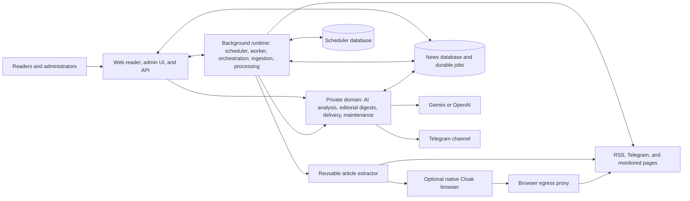

# Evening News

Evening News collects stories from RSS/Atom feeds, public Telegram channels, and monitored web pages. It extracts article text, generates AI summaries and categories, and publishes editorial digests to Telegram and a public web reader.

**Live site:** [news.dzarlax.dev](https://news.dzarlax.dev)

Originally written in Python, the application now runs on Go.

## Features

- RSS/Atom, public Telegram channel, and CSS-based Page Monitor sources.
- Full-text extraction with HTTP and optional native Cloak browser support.
- Duplicate detection, content filtering, AI summaries, and categorization.
- Russian and optional Serbian Latin articles and digests, with a shared editorial composition and separate delivery channels.
- Telegram delivery and permanent digest pages on the website.
- A searchable public reader with category/source filters, dark mode, and mobile layouts.
- Russian/Serbian public, admin, login, and setup interfaces for providers, credentials, sources, categories, schedules, and processing limits.

## How a story becomes a digest

1. Collect articles and save source receipts in PostgreSQL.
2. Extract full text where needed and filter duplicate or unsuitable content.
3. Generate an article summary and categories with the selected AI provider.
4. Build an editorial edition from the saved summaries, selecting main stories and grouping short items.
5. Validate the edition, add links in code, save it, and deliver it to Telegram.

Headlines link to the article on this site. Website source labels link to the original publication; Telegram displays source names as plain text. Stored editions retain their article snapshot and delivery receipts. See [editorial digest contracts](docs/editorial-digests.md) and [digest delivery](docs/go-digest-delivery.md).

## Architecture

Components follow product responsibilities and can evolve independently. Several components share one process rather than requiring a separate container for each task.



The application has four main runtimes: web, background, private domain, and extractor. Native browser extraction additionally uses a browser and protective egress proxy. The extractor is independently deployable and reusable. Private HTTP interfaces use service authentication, and database-backed ownership fences protect background work. PostgreSQL stores articles, configuration, durable jobs, editions, and delivery receipts; schedules use a separate database.

The application processes use Go. The optional browser stack has its own Python launcher and policy/relay tooling.

## Quick start

Requirements: Docker with Compose v2 and Make.

```sh
cp .env.example .env
make managed-up
make managed-token
```

Open [http://localhost:8000/setup](http://localhost:8000/setup), enter the one-time token, and create the administrator account. The token expires after 15 minutes and can only be used once.

The installer creates PostgreSQL databases, restricted runtime roles, passwords, signing keys, and private service configuration automatically. Installation state lives in persistent volumes. No AI or Telegram credentials are needed to start the application; add them in the setup screens before running the corresponding jobs.

The default installation uses HTTP extraction and binds the web port to `127.0.0.1`. An optional protected installer flow attaches an existing native Cloak browser and egress stack.

```sh
make managed-logs  # Follow service logs
make managed-stop # Stop services while preserving data
```

## Configuration

For a fresh managed installation, `.env` can be empty. Its only optional input is `SITE_BASE_URL`; the default is `http://localhost:8000`. Public installations require HTTPS and explicit trusted proxy CIDRs supplied through protected installer options.

Configure everyday application settings through the web interface:

- **AI:** Gemini/OpenAI credentials, active provider, and models for articles, digests, and auxiliary text.
- **Telegram:** one protected bot token, Russian digest and service channels, and an optional separate Serbian digest channel.
- **Sources and categories:** feeds, channel/page settings, categories, and mappings.
- **Schedules:** collection and digest timing.
- **Processing:** article limits, publication age/date filters, processing/delivery switches, and opt-in Serbian generation.

Saved provider and Telegram credentials are encrypted in PostgreSQL and are never returned by the settings API. Operational settings apply to new jobs; running jobs keep their configuration snapshot.

The interface language selector supports `ru` and `sr-Latn`. Russian public URLs remain valid; Serbian reader links carry `?locale=sr-Latn`. A missing Serbian translation has an explicit unavailable state. Changing the interface language does not enable generation or change publication channels.

Enable Serbian generation in processing settings and configure a distinct Serbian channel in Telegram settings. Existing articles are not automatically backfilled. Failed Serbian text is retried independently from completed Russian text, and editorial retries keep the original composition and saved input versions. Settings recovery preserves the Serbian destination but disables delivery until it is explicitly enabled again. See [localization contracts](docs/localization.md).

Infrastructure settings remain operator-managed: database connections, networks, browser endpoints, proxy trust, resource limits, concurrency, and technical timeouts. Managed services read private per-role files through `NEWS_RUNTIME_FILE`. These files, encryption keys, and database volumes must be preserved together for recovery.

See the [configuration guide](docs/configuration.md), [complete environment example](deploy/config/full.env.example), and [machine-readable configuration catalog](go-tools/configcatalog/catalog.json) for advanced installation and generated configurations. The full example is a reference, not a file to enable wholesale. The alternative `make dev` profile is documented in the [local deployment guide](deploy/news/README.md).

## AI providers

Gemini and OpenAI support article analysis, editorial digest generation, and auxiliary text generation. Each installation selects one active provider and a model for each purpose. There is no automatic provider fallback: a missing active key or model produces an error.

The independent [go-ai module](https://github.com/Dzarlax-AI/go-ai) provides shared text and structured JSON interfaces. News owns prompts, validation, retries, editorial rules, and usage accounting. Model-generated output supplies content and article references; application code constructs links and renders the edition.

Optional operator-supplied model prices enable cost estimates. Missing provider usage or pricing remains unknown rather than being reported as free. Saving AI settings does not make a provider request; processing and digest jobs do.

## Web interface and API

- `/` and `/list`: public reader.
- `/search`: article search.
- `/digest/YYYY-MM-DD`: daily digest.
- `/admin`: administration and job status.
- `/setup`: installation and provider/Telegram configuration.
- `/health`: service health.
- `/api/public/`: public data API.
- `/api/v1/`: authenticated management API.
- `/openapi.json`, `/docs`, `/redoc`: API schema and documentation.

Asynchronous admin commands return a durable job receipt. Offline backup upload, cleanup, and restore operations are disabled in worker mode. For managed installations with an external database and native browser, use the [operator settings backup and recovery procedure](docs/managed-settings-recovery.md). It recovers configuration, not article history; the admin page provides guidance instead of restore controls. Other recovery support depends on the installation profile; consult the [configuration guide](docs/configuration.md). A database dump alone cannot recover encrypted credentials without the matching private key material.

## Development and tests

```sh
make test
make vet
```

Go modules can also be checked independently with `go test -race ./...`, `go vet ./...`, and `go mod verify` from their directories. PostgreSQL integration tests require an isolated loopback test database via `TEST_DATABASE_URL`. Never point tests at a production or shared database. Provider tests use synthetic responses; real-provider calls incur costs.

## Technical documentation

- [Configuration and installation](docs/configuration.md)
- [Web/API components](docs/web-api-components.md)
- [Core images and release](docs/core-image-build-and-release.md)
- [Execution and orchestration](docs/execution-and-orchestration-contract.md)
- [Web route coverage](docs/web-api-route-coverage.md)
- [Article ingestion](docs/go-article-ingestion.md)
- [Article processing](docs/go-article-processing.md)
- [Scheduler](docs/go-scheduler.md)
- [Source collection](docs/go-source-manager.md)
- [Telegram collection](docs/go-telegram-source.md)
- [Page Monitor](docs/go-page-monitor.md)
- [Native browser worker](docs/go-cloak-native-worker.md)
