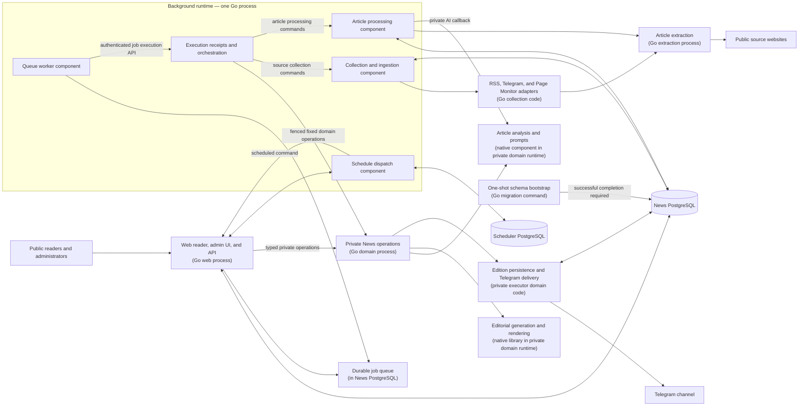

# Evening News

Evening News collects stories from RSS/Atom feeds, public Telegram channels, and monitored web pages. It extracts article text, filters low-quality content, generates AI summaries and categories, and publishes daily digests to Telegram and the public reader.

**Live site:** [news.dzarlax.dev](https://news.dzarlax.dev)

## What it does

1. Collects articles from configured feeds, Telegram channels, and custom pages.
2. Extracts full text from linked articles when a source provides only a snippet.
3. Filters duplicate, short, and boilerplate content before article analysis.
4. Summarizes and categorizes articles, then creates daily summaries by category.
5. Publishes digests to Telegram and links to the public site.

## Architecture

The application is organized around product responsibilities. The diagram describes the current development candidate and its logical responsibilities; it does not imply a production deployment.



The Go web service serves the public reader, admin pages, health endpoints, and management APIs. One Go background process hosts the scheduler, queue worker, ingestion, article processing and execution components. The private Go domain process owns analysis, callbacks, editorial generation, Telegram delivery and maintenance. The extractor remains a separate Go service. The private domain and background processes communicate over authenticated HTTP and use database-backed ownership fences.

The one-shot `news-migrate` command runs before schema-dependent services start; the web and domain processes do not apply migrations at startup. `WEB_BACKEND_URL` names the private domain origin, and `WEB_BACKEND_TOKEN` is shared by the web and domain processes. Provider credentials belong to the domain process, not the web process. Delivery receipts and failure semantics are described in [Go digest delivery](docs/go-digest-delivery.md).

The final Go domain migration is a development candidate. The image acceptance, recovery and backup gates must pass before it can be considered ready for release; no deployment is implied by the source tree.

## Editorial digests

Article analysis and editorial generation use the private domain runtime. The Russian editorial format presents main stories first, followed by short stories grouped by category. The editorial engine is linked into that process. Stored editions preserve their article snapshot and source links. Headlines open a page on this site, while source labels open the original publication. See [editorial digest contracts and boundaries](docs/editorial-digests.md).

## Admin panel

The admin UI is served at `/admin`. It provides source and category management, summaries and statistics, Telegram settings, schedule settings, and backup operations. Commands that run asynchronously are submitted to the durable job queue and report a job receipt. In worker mode, offline backup mutations such as upload, cleanup, and restore are disabled by the private executor.

## Public reader and API

The public reader is available at `/` and `/list`, with search at `/search` and daily digests at `/digest/YYYY-MM-DD`. It includes filtering by category and source, dark mode, and a responsive article view.

Public data endpoints live under `/api/public/`; the authenticated management API lives under `/api/v1/`. The route ledger is in [Go web route coverage](docs/web-api-route-coverage.md), and the frozen historical Python route/schema snapshot remains under `tests/fixtures/web-contract-v1/` for migration tests. The public OpenAPI contract is `go-web/contracts/openapi.json` and is served at `/openapi.json` with local documentation at `/docs` and `/redoc`.

## Local development

The example Compose stack starts the Go web service, one background runtime, the private Go domain executor, the extractor, and separate PostgreSQL instances for News and scheduler data. A one-shot migration command uses the executor image before schema-dependent services start. It does not include the production egress policy service or shared browser. The production layout is documented separately; the minimal local profile uses HTTP-only extraction and does not include browser rendering.

Copy `.env.example` to `.env` and replace its development placeholders. It lists every required Compose key, including distinct web, executor, scheduler, worker, ingestion, and processing database URLs. Follow the local database setup sequence in [the News deployment guide](deploy/news/README.md) to migrate first, then provision the ingestion and processing roles before starting the background service. The local worker DSN uses `newsuser`; that owner role is only for the disposable local profile.

```sh
cp .env.example .env
```

Provider keys are configured on the private domain executor, which owns Gemini transport and Telegram delivery. The local Compose file maps `WEB_DATABASE_URL` to the web service's `DATABASE_URL` and `EXECUTOR_DATABASE_URL` to the executor and migration service's `DATABASE_URL`. The background components use separate worker, execution, scheduler, ingestion, and processing database variables. The Go web service receives its database URL, admin/JWT settings, `WEB_BACKEND_URL` and `WEB_BACKEND_TOKEN`, scheduler client settings, and HTTP trust configuration; it does not receive AI or Telegram provider keys.

Complete the migration and runtime-role provisioning sequence in [the News deployment guide](deploy/news/README.md#fresh-local-compose-database-setup) before starting the full stack. Then start the remaining services:

```sh
docker compose -f docker-compose.example.yml up --build -d
```

The app is available at `http://localhost:8000`. The `migrate` service exits after its one-shot bootstrap; inspect its logs if schema-dependent services do not start. The dev overlay is optional:

```sh
docker compose -f docker-compose.example.yml -f docker-compose.dev.yml up --build -d
```

## Tests

The Go components can be checked independently with `go test -race ./...`, `go vet ./...`, and `go mod verify` from each module directory. PostgreSQL integration tests require `TEST_DATABASE_URL` to point to a dedicated loopback test database. Do not use a production or shared database.

The image acceptance gate and migration coverage are still being completed; see [the Go tooling coverage map](go-tools/COVERAGE.md) for verified checks and outstanding work. The legacy Python tests and CI paths remain until equivalent checks are established.

## Configuration and documentation

The Compose example is the source of truth for the complete local service configuration. The Go web environment includes `DATABASE_URL`, `ADMIN_USERNAME`, `ADMIN_PASSWORD`, `JWT_SECRET`, `WEB_BACKEND_URL`, `WEB_BACKEND_TOKEN`, scheduler receiver settings, and HTTP trust settings. `WEB_BACKEND_URL` must be a fixed executor origin; the client does not accept arbitrary backend paths or URLs. The background runtime receives five component-specific database URLs; provision the execution role explicitly and do not fall back to the worker DSN. Production environment preparation and explicit per-service mappings are documented in [the News deployment guide](deploy/news/README.md).

English technical guides:

- [Web/API components](docs/web-api-components.md)
- [Core image build and release](docs/core-image-build-and-release.md)
- [Execution and orchestration contract](docs/execution-and-orchestration-contract.md)
- [Go web route coverage](docs/web-api-route-coverage.md)
- [Article ingestion](docs/go-article-ingestion.md)
- [Article processing](docs/go-article-processing.md)
- [Go scheduler](docs/go-scheduler.md)
- [Source collection](docs/go-source-manager.md)
- [Telegram collection](docs/go-telegram-source.md)
- [Page Monitor](docs/go-page-monitor.md)
- [Native browser worker](docs/go-cloak-native-worker.md)

PR33's production consolidation was deployed on 2026-10-26. At that time it ran five News-owned containers: the Go web app, one Go background runtime, the Python executor, the extractor, and protective egress. That deployed state predates the final Go domain candidate. The local Compose example uses local PostgreSQL containers; production uses deployment-specific networking, database placement, browser integration, and pinned image digests.
