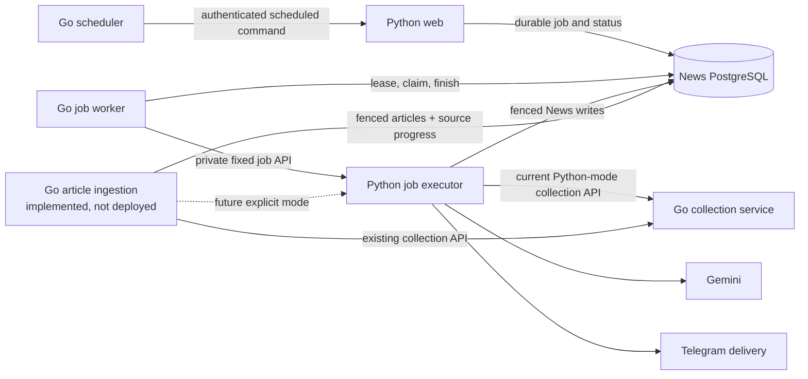

# Background job worker

The Go worker is the only process that owns and consumes the durable News job
queue. The Python web app accepts jobs and reads their status. A separate,
private Python executor performs the existing News operations after Go claims a
job. `NewsOrchestrator.run_full_cycle` and its internal pipeline remain Python.
The Go worker owns queue lifecycle; Python owns News orchestration and AI.

The standalone Go scheduler continues to own calendar timing and dispatch. The
separate Go collection service continues to own source collection and article
extraction. They are independent services with their existing APIs.

Article persistence has a separate, explicit mode boundary. The current
default remains Python collection and persistence through the database-free Go
collector. A database-aware Go article ingestion service is implemented but
not deployed. If enabled in a future deployment, the Python executor calls it
within the current job fence; it reads source configuration, calls the
existing collector, and commits articles and source progress. Python then
continues quality checks, AI processing, summaries, and delivery. The service
does not own the queue or replace the executor.



## Runtime and configuration

The standalone example stack in `docker-compose.example.yml` runs the web app,
Go worker, private Python executor, Go collection service, Go scheduler, and
separate News and scheduler PostgreSQL databases. The standalone ingestion
template is maintained separately and is not included in this example stack.
The executor and worker have
no published host ports. Worker traffic reaches the executor directly over the
Compose network.

Set `JOB_EXECUTOR_TOKEN` to an independent printable ASCII service token at
least 16 characters long. The same token is configured only on the worker and
executor. The Go worker also needs `DATABASE_URL` and `JOB_EXECUTOR_URL`. Queue
limits remain configurable through `WORKER_POLL_INTERVAL_SECONDS` (1–10,
default 1), `WORKER_SHUTDOWN_DRAIN_SECONDS` (0–120, default 20),
`WORKER_MAX_JOB_ATTEMPTS` (1–10, default 3), and
`WORKER_JOB_RETENTION_DAYS` (1–90, default 7). The executor uses the app's
existing AI, collection-service, and scheduler-client configuration.

Both background containers use a 180-second Compose stop grace, covering the
supported drain range (up to 120 seconds) plus bounded cancellation and database
cleanup. They exit sooner when idle or drained. If overriding shutdown or RPC
timeouts in a custom deployment, keep container stop grace greater than the
drain plus all cancellation and database cleanup budgets; the default RPC
configuration requires at least 60 seconds beyond the drain.

Run exactly one Python executor per News database schema. It holds its own
PostgreSQL session advisory lock and refuses startup while another executor
owns that lock. Its lock is separate from Go's queue-owner lease. Point the
worker directly at this singleton; do not load-balance requests across executor
instances or overlap replacement instances. Stop and replace the executor in
place so a changed instance identity proves the previous process has exited.
This is the supported topology and does not claim exactly-once AI billing or
external delivery across a database or network partition.

The executor binds port 8100 inside the Compose network. Its fixed private API
requires the bearer token and accepts only a versioned job envelope containing
owner, generation, attempt, and immutable deadline. It reads the job kind and
payload from PostgreSQL. It does not accept arbitrary code, commands, or URLs.
The job receipt is committed before execution starts, so Go resolves a lost
response by polling the same receipt rather than submitting another attempt.
An HTTP timeout alone never proves that Python stopped. Shutdown, cancellation,
lease loss, and recovery preserve that rule; uncertain external sends finish as
`delivery_unknown` and are not replayed automatically.

## Queue behavior

The existing producer API, idempotency keys, queue-position ordering, maximum
of 32 queued/interrupted jobs, scheduler occurrence receipts, and job-status
API remain in Python/PostgreSQL. The Go worker claims one job at a time and
preserves the eight existing operation kinds:
`news_processing`, `news_digest`, `telegram_digest`, `backup`,
`reprocess_failed`, `article_reprocess`, `summaries_generate`, and
`source_test`.

PostgreSQL advisory lock acquisition, owner generation, worker status, and
heartbeat checks follow the existing SQL contract. Go records the lease backend
PID; Python verifies that exact backend still holds the expected advisory lock
with a fresh heartbeat. Every domain commit is fenced under the worker/job row
locks. Attempt-specific backup files and the domain-statistics cache use a
publication fence as they touch the filesystem.

When another backend still holds the worker lease at startup, Go waits for at
most 20 seconds, retrying once per second. It does not claim jobs or notify the
executor of recovery before acquisition succeeds. Other startup errors fail
immediately. Heartbeat failures still invalidate ownership and stop execution;
bounded diagnostics report the failed stage and a finite reason or SQLSTATE,
without logging driver messages or connection details. These diagnostics help
distinguish connection loss from row-lock contention; they do not establish the
cause of a historical production restart by themselves.

Job results are bounded to 4 KiB. A repeated identical envelope returns its
durable receipt; a changed envelope conflicts. Go writes the terminal News job
state before asking Python to apply fixed legacy schedule-completion and alert
effects. Pending completion events remain durable until Python acknowledges
them, even when normal job retention expires. Scheduler occurrence receipts
remain governed by their existing independent retention contract.

Scheduled `news_processing` runs use source-specific alert confirmation when a
successful Go ingestion receipt proves that the only warning is one retryable
source transport failure. A source incident requires two consecutive scheduled
observations for the same source and configuration; recovery requires two
healthy observations. Manual jobs, other schedules, changed configurations, and
missing observations do not establish such a streak. The source receipts and
job warning remain visible even when the first notification is suppressed.

The executor keeps bounded incident and delivery markers in reserved
`scheduled_source_alerts:v1:` JSON settings. Completion replay does not send an
alert again, and an uncertain delivery is not blindly retried. Unknown
warnings, failed jobs, and AI/delivery failures retain the immediate generic
alert path. No new database migration or job-result field is required.

Selected-article `article_reprocess` initialization remains a one-time fenced
Python operation. Retry counters and completed article stages survive worker
recovery. The Python executor does not run a hidden queue consumer. The old
`python -m news_aggregator.worker` entrypoint fails closed with a migration
message; use the Go worker and Python executor processes instead.

## Local checks and isolated acceptance

Run the Go module checks with Go 1.25.6:

```sh
cd go-worker
go test -race ./...
go vet ./...
```

The PostgreSQL store tests run only when `TEST_DATABASE_URL` points to a
loopback test database. They create and remove an isolated schema. Run the
Python contract and regression suite with the corresponding isolated
`TEST_DATABASE_URL` and `DATABASE_URL` values:

```sh
python -m pytest -q
```

CI builds `docker/Dockerfile` and `go-worker/Dockerfile`, then runs
`scripts/run_go_job_worker_fixture_gate.py` against an internal Docker network
with fake provider services and synthetic PostgreSQL data. The gate checks
cross-language queue ownership, public/admin job paths, supported job kinds,
worker and executor restarts, backup sharing, and conservative delivery
recovery. It does not contact real sites, AI providers, or messaging services.
After those checks pass on `main`, CI publishes the worker as
`ghcr.io/dzarlax-ai/rss-job-worker:sha-<commit>` and uploads the immutable
`ghcr.io/dzarlax-ai/rss-job-worker@sha256:…` reference as the
`go-job-worker-image` artifact. Pull a specific main revision with:

```sh
WORKER_IMAGE="ghcr.io/dzarlax-ai/rss-job-worker:sha-$(git rev-parse HEAD)"
docker pull "$WORKER_IMAGE"
```

Build the Go image from the repository root because the Dockerfile copies
`go-worker/` paths from that context:

```sh
docker build -f go-worker/Dockerfile -t evening-news-job-worker:local .
```

The standalone Python worker gate describes the superseded runtime and is not
the current acceptance command. The full Python `DurableBackgroundWorker`
class remains only as compatibility code for focused migration/fence tests and
must not be started as a queue consumer.

## Boundaries

Production cutover, database migration on production, image publication, and
deployment are separate decisions. Do not switch a live queue owner until the
new images and isolated gate pass, accepted jobs and receipts are inventoried,
and the old owner has drained or been stopped. Keep backups and receipt data;
do not restore an old database snapshot over a live queue.

The Go worker moves queue lease, claim, timeout, recovery, retention, and job
state transitions. Python continues to perform News domain work, including
`run_full_cycle`, article processing, AI, summaries, and delivery. Any later
port of the News orchestration sequence requires a separate stage contract and
validation.
