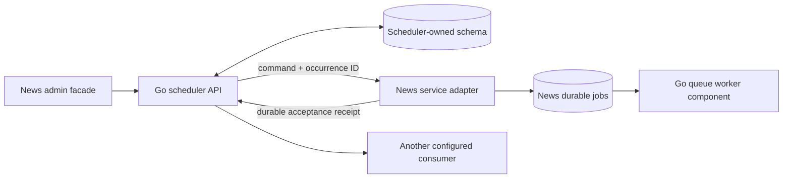

# Go scheduler component

The scheduler remains a separate Go module and private HTTP/API boundary. The
current local Compose example runs it inside the Go `background` runtime rather
than a standalone container. The approved core image build/release process is
documented in [Core image build and release](core-image-build-and-release.md).
This consolidation has not been published or rolled out to production.

The scheduler is a separate Go service with its own image, PostgreSQL schema,
API, and deployment lifecycle. It owns calendars and reliable command dispatch.
It has no access to News articles, background jobs, Gemini, Telegram, or the
browser. Its HTTP wire format is specified in the
[versioned contract](go-scheduler-contract.md).

The scheduler owns its state in a separate PostgreSQL database/schema. Its
historical standalone production release is recorded in
[the dated release record](../deploy/news-scheduler/RELEASE_2026-10-23.md); that
record does not describe this source change or a production consolidation.

## Core image publication

The previous standalone scheduler image workflow has been removed. The
canonical core release workflow tests and publishes the `web`, `background`,
and `executor` targets together on an explicit reviewed-main dispatch. It does
not publish on pull requests or ordinary pushes, and this consolidation has
not been published. See [the core image release guide](core-image-build-and-release.md)
for the current release gate and immutable image inventory.

## Ownership and execution

A calendar becomes a concrete occurrence at its scheduled time. The scheduler
writes that occurrence, its outgoing command, and the next due time in one
transaction. HTTP happens after commit. A dispatcher lease fences stale attempts;
retries preserve the occurrence ID and immutable envelope. Outbox availability,
claim leases, fencing, and Retry-After interpretation use PostgreSQL time;
relative retry delays are rebased onto that clock, including operator retry.

A valid receipt means that the consumer durably accepted work. It does not mean
the work succeeded. News reports execution results from its own job records.
The Python worker retains article processing, AI, job ownership/recovery, and
conservative handling of ambiguous digest delivery.

Daily schedules now follow local civil dates. When a configured wall time is
ambiguous during an autumn fold, the first instant is the day's occurrence; if
that instant has passed, the second fold instant is skipped. A nonexistent wall
time during a spring gap is shifted forward by the transition's actual offset
change (60 minutes in Belgrade, 30 minutes in Lord Howe). A fully skipped local
date has no occurrence; a gap adjustment that would cross local midnight is
also skipped to prevent two occurrences on one local date. Daily weekday filters
use the local calendar date.
Hourly, weekly, and interval calculations are unchanged. Imports preserve their
stored `next_due_at` exactly; the civil-time policy is applied when the scheduler
calculates the next due time after an occurrence. After a daily occurrence, the
next due date must follow the local date represented by that occurrence's
`scheduled_for`, even when the imported instant used a stale UTC offset.

The services may share one PostgreSQL server. Use different database roles and
schemas: the scheduler role must not read or write the News schema, and the News
role must not write scheduler tables. The scheduler creates only its own schema
objects. Provision schema ownership and credentials outside the application;
never give either runtime a database superuser account.

## Configuration

Scheduler settings:

| Variable | Meaning |
|---|---|
| `SCHEDULER_DATABASE_URL` | PostgreSQL DSN for the scheduler role, using `postgres://` or `postgresql://` |
| `SCHEDULER_DB_SCHEMA` | Explicit scheduler-owned schema |
| `SCHEDULER_API_TOKEN` | Token for calendar/control/inventory API access |
| `SCHEDULER_TARGET_ALIASES` | Static comma-separated consumer aliases |
| `SCHEDULER_TARGET_NEWS_WORKER_URL` | News adapter endpoint for alias `news-worker` |
| `SCHEDULER_TARGET_NEWS_WORKER_TOKEN` | Consumer-scoped token; separate from the calendar API token |
| `SCHEDULER_START_PAUSED` | Initial control state only; persisted state wins after initialization |
| `SCHEDULER_ALLOW_HTTP_TARGETS` | Explicit opt-in for statically configured HTTP targets on private networks |
| `LISTEN_ADDR` | Private API listener, default `:8080` |

HTTPS targets are the default. Schedule clients select aliases, never arbitrary
URLs or headers. Redirects are not followed. Keep the listener private and do not
publish a public router for this service. Neither status nor logs should expose
target credentials, database credentials, or application payloads.

News settings:

| Variable | Meaning |
|---|---|
| `BACKGROUND_EXECUTION_MODE=worker` | Preserve the separate execution worker |
| `SCHEDULE_DISPATCH_MODE=service` | Stop the Python schedule loop and use the service facade |
| `SCHEDULER_API_URL` | Private scheduler API base URL |
| `SCHEDULER_API_TOKEN` | Scheduler calendar/control API token |
| `SCHEDULER_API_ALLOW_HTTP` | Explicit opt-in for a private HTTP scheduler endpoint |
| `SCHEDULED_JOBS_TOKEN` | Token accepted only by the News scheduled-command adapter |
| `SCHEDULED_JOBS_RECEIPT_LIMIT` | Durable receipt capacity, default and maximum 100,000 |
| `SCHEDULER_HTTP_TIMEOUT_SECONDS` | Bounded scheduler client timeout, default 5 seconds |

The offline `scheduler_bridge.py import` and `rollback-inventory` commands use
HTTPS by default. Their explicit `--allow-http` opt-in is also supported for a
scheduler API reachable only over an isolated private test or deployment
network; never use it for a public or untrusted network path.

The News endpoint is `POST /api/v1/internal/scheduled-jobs`. It requires the
consumer-scoped bearer token, independently of administrator login. It validates
the envelope and supported News operations before writing anything. The accepted
operations are `news_processing`, `news_digest`, `telegram_digest`, `backup`, and
`reprocess_failed`.

## Retries and receipts

Delivery is at least once; consumer acceptance is idempotent. If the HTTP response
is lost after News commits, a repeated occurrence returns the original job ID.
A reused occurrence ID with different content is rejected. Queue saturation or
an unavailable worker leaves the scheduler command pending for later delivery.

News keeps compact receipt tombstones independently of terminal job retention.
Otherwise a response lost for longer than the job retention period could create
another job when retried. Tombstones contain occurrence identity, envelope hash,
and job identity; they do not contain article content or tokens. New acceptance
fails closed when receipt capacity is reached. There is no automatic receipt
purge without a protocol proving that replay protection is no longer needed.

Authentication and permanently invalid commands become visible blocked outbox
entries rather than rapid retries. Pending and blocked entries are not removed
by age. Operator retry preserves the same occurrence identity; accepted commands
must not be replayed as new work. Global pause retains all state and prevents
new occurrences and dispatch; it does not cancel an HTTP request already in
flight or undo an already accepted News job.

## Migration and rollback

The News app uses service dispatch while `SCHEDULER_ENABLED=false`; this
deprecated setting is inert and does not control Go scheduling. Schedule
CRUD/status and calendar dispatch belong to the standalone service. The Go
scheduler control is unpaused. The migration bridge
imports News configuration and exact due instants; the scheduler does not
connect directly to the News database. Enabled imports require a non-null due
time; disabled imports require null. Stable keys use `news:<legacy_id>`, and
imported UTC due times retain microseconds.

For rollback, pause the scheduler and inventory pending/blocked/accepted
occurrences and News jobs. The bridge rejects unpaused or changing control state
and any active News dispatch lease before writing an inventory artifact.
Expired leases remain visible with database-clock lease status. Occurrences and
execution jobs belonging to deleted News schedules remain in inventory; their
configuration is not recreated. Export current calendar configuration and next due
times into an isolated inventory before restoring a previously approved
Go-compatible release. There is no Python calendar runtime to resume. Never
restore an old configuration snapshot blindly, delete outbox entries, or discard jobs.
The shared collector, browser, egress gateway, and their clients are outside the
scheduler rollout.

## Verification

The service has its own Go tests and race checks, plus an internal-network Docker
acceptance gate that runs the actual scheduler binary with News web, its Python
worker, PostgreSQL with separate roles, fake providers, and another generic
consumer. Real sites, AI providers, and Telegram are excluded.

The scheduler health command is `scheduler healthcheck`. `/healthz` checks process
liveness; `/readyz` additionally checks schema/DB readiness and loop freshness.
An open port or a successful acceptance receipt alone is not execution acceptance.
Pre-release local verification on October 23, 2026:

- Python regression suite against isolated PostgreSQL 16: 1,261 passed, five
  explicit real-browser/network checks skipped, and 22 subtests passed.
- Go unit and PostgreSQL integration tests passed with the race detector;
  `go vet` and Linux amd64 / macOS ARM64 cross-compilation passed.
- Combined internal-network Docker gate: all 46 checks passed, including real
  command acceptance/execution, a second opaque consumer, lost receipts,
  full-queue 503/retry, separate role permissions, and one deliberate restart
  each of scheduler, web, and worker. No OOM or automatic restarts; cleanup passed.
  Both runtime source hashes matched the checkout.
- Independent review findings were corrected and reviewed again. PR/CI checks
  are recorded separately against the submitted commit.

The isolated acceptance checks use synthetic workloads. They do not establish
production memory savings, throughput, public-route access policy, or production
migration safety. The five skipped checks require a separate real-browser/network
opt-in. Receipt storage is intentionally capped and has no automatic purge;
monitor capacity during operation.

Production deployment and first scheduled execution were verified on October 23,
2026. The release record lists immutable app/scheduler digests, imported due-time
verification, access checks, first natural delivery, and observed restart/OOM state.
Those checks establish the recorded deployment path only; resource snapshots are
point-in-time observations rather than peak measurements.

Synthetic Docker resource snapshots (MiB; CPU percent in parentheses):

| Process | Slow target in flight | News queue at capacity | Final |
|---|---:|---:|---:|
| Scheduler | 6.62 (0.75%) | 7.24 (1.11%) | 7.37 (1.03%) |
| News web | 101.30 (0.25%) | 101.80 (0.25%) | 96.45 (0.23%) |
| News worker | 81.93 (0.66%) | 82.65 (0.00%) | 76.75 (0.71%) |
| PostgreSQL | 97.97 (0.81%) | 101.40 (1.12%) | 92.16 (1.28%) |
| Fake consumers/providers | 13.11 (0.05%) | 12.86 (0.04%) | 12.04 (0.05%) |
| Total | 300.93 (2.52%) | 305.95 (2.52%) | 284.77 (3.30%) |

The scheduler used 5.39 MiB before dispatch; that idle sample was captured
before starting the worker, so its 203.19 MiB total is not comparable with the
full five-process samples. These are point-in-time observations from a small
synthetic workload, not peak measurements or production sizing evidence.
The capacity check observed 32 queued jobs and one running job with a live
worker heartbeat; no worker pause or runtime timeout changes were needed.
