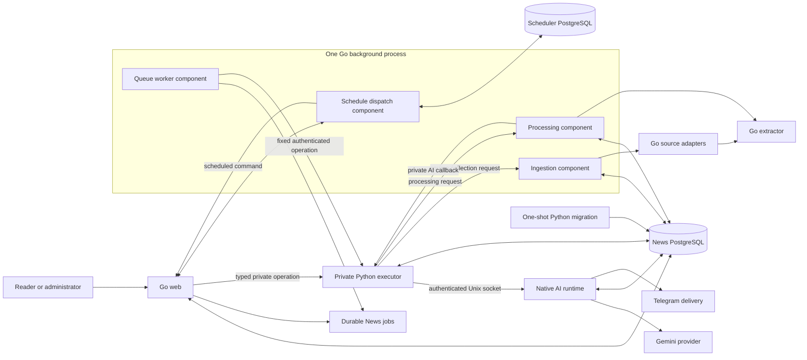

# Web and API components

> Historical migration context: the Python executor and Unix child described below predate the current Go domain candidate. For its runtime and unfinished acceptance, see [Private Go domain runtime](go-domain-runtime.md).

This document describes the local Compose architecture. It is not a production
deployment record. The background runtime packaging in this branch has not
been published or rolled out.

## Responsibilities

| Responsibility | Runtime placement | Owns |
|---|---|---|
| Public reader and web API | Go `web` process | Public pages and data APIs, admin pages, authentication, management routes, API documentation, HTTP trust middleware, and the narrow calls to the private executor |
| Durable command management | Go web packages and News PostgreSQL | Source/category CRUD, summaries and statistics reads, settings, durable job submission, and receipts |
| Queue execution | Go `background` process | The queue worker component, claims, lease/recovery handling, and fixed authenticated operations sent to the executor |
| Schedule dispatch | Go `background` process | Scheduler API and dispatch component; scheduler state remains in its separate PostgreSQL database |
| Collection and ingestion | Go `background` process | Ingestion listener, RSS/Atom, public Telegram and Page Monitor adapters, source progress, and fenced article persistence |
| Article processing | Go `background` process | Processing listener, article selection, state transitions, retries, and article/category persistence; AI analysis calls the private executor |
| Private domain operations | Existing `executor` runtime with Python PID 1 and one long-lived Go AI child | Fixed operation and claim boundaries, native editorial workflow, receipt-backed Telegram delivery, article analysis and Gemini transport, shared provider admission and breaker, metadata and best-effort usage persistence, diagnostics, and backup operations |
| Extraction | Separate Go `extractor` process | Bounded HTTP extraction. The example Compose profile uses HTTP-only extraction. |
| Schema bootstrap | One-shot `migrate` command using the executor image | Existing database initialization, versioned migrations, and required schema checks before schema consumers start |

The scheduler, worker, ingestion, and processing remain distinct Go modules and
components with their own typed configuration, database pools, and listeners.
They run together in one background process in the Compose example; they are
not independently deployed containers there. The build graph still creates
separate `web`, `background`, and `executor` runtime images. The extractor keeps
its own image, and the shared browser stays outside this local example.

## Request and data flow



The Go web is the only web UI/API implementation in the local example. It owns
`/`, public feed pages and APIs, `/admin`, authenticated management endpoints,
health endpoints, and the documented route contract. The executor exposes
fixed authenticated internal operations and is not mounted into the public Go
mux.

The Go worker uses the durable News queue and dispatches fixed job names and
validated payloads to the executor. Collection, ingestion, article processing,
and extraction retain their private HTTP contracts on the shared background
service hostname at ports `8080`, `8093`, and `8094`; background health uses
`8095`. Compose does not publish these private ports on the host.

## Database lifecycle and configuration

`migrate` runs this command and exits after the one-shot bootstrap:

```sh
python -m news_aggregator.migrate
```

The Go web checks the required schema at startup and does not apply DDL. The
scheduler keeps its own database and schema. Schema-dependent services wait for
successful migration completion.

The background runtime requires four independent connection strings:

| Variable | Component |
|---|---|
| `WORKER_DATABASE_URL` | Queue worker |
| `SCHEDULER_DATABASE_URL` | Scheduler |
| `INGESTION_DATABASE_URL` | Ingestion |
| `PROCESSING_DATABASE_URL` | Article processing |

Provide each News database URL using the corresponding provisioned least-
privilege role. The example does not create these roles or substitute the
executor's `DATABASE_URL` for them. The scheduler URL points to its separate
database. Keep credentials in an ignored `.env` file or the shell environment;
do not put DSNs in source control or diagnostics.

The executor retains the News `DATABASE_URL` and provider credentials. It starts
the AI child before becoming ready. The child accepts only authenticated
Unix-socket requests and is stopped after active executor operations are
canceled. The native pool reserves two connections from the executor's existing
pool budget; at least two remain for the Python guard and normal operations.
The Go
web gets a separate `WEB_BACKEND_TOKEN` for its fixed executor origin:

| Variable | Purpose |
|---|---|
| `WEB_BACKEND_URL` | Private executor origin, such as `http://executor:8100` |
| `WEB_BACKEND_TOKEN` | Bearer credential for Go web to executor operations |
| `JOB_EXECUTOR_URL` / `JOB_EXECUTOR_TOKEN` | Worker-to-executor job boundary |
| `ARTICLE_INGESTION_URL` / `ARTICLE_INGESTION_TOKEN` | Executor-to-background ingestion boundary |
| `ARTICLE_PROCESSING_URL` / `ARTICLE_PROCESSING_TOKEN` | Executor-to-background processing boundary |
| `SCHEDULER_API_URL` / `SCHEDULER_API_TOKEN` | Web and executor scheduler client configuration |

Provider keys such as `GEMINI_API_KEY` and `TELEGRAM_TOKEN` remain in the
private executor; the parent passes the token explicitly to its native child. They are not required by the Go web or background image. The full
local example is in [`docker-compose.example.yml`](../docker-compose.example.yml).

## Local checks

Run the Python suite and the Go checks from the repository root:

```sh
python -m pytest tests -q
for module in go-worker go-scheduler go-ingestion go-processing go-background go-web; do
  (cd "$module" && go test -race -count=1 ./... && go vet ./... && go mod verify)
done
(cd go-domain && go test -race -count=1 ./... && go vet ./... && go mod verify)
```

PostgreSQL integration tests require dedicated loopback-only databases. Do not
use a production or shared database. Core image builds, runtime contents, and
the consolidated synthetic fixture command are documented in
[`core-image-build-and-release.md`](core-image-build-and-release.md).

The historical Python route and OpenAPI capture under
`tests/fixtures/web-contract-v1/` remains migration input. Go route tests compare
the assembled mux with that frozen inventory and compare the API document with
the checked-in Go OpenAPI contract; they do not import the removed Python web
application.
